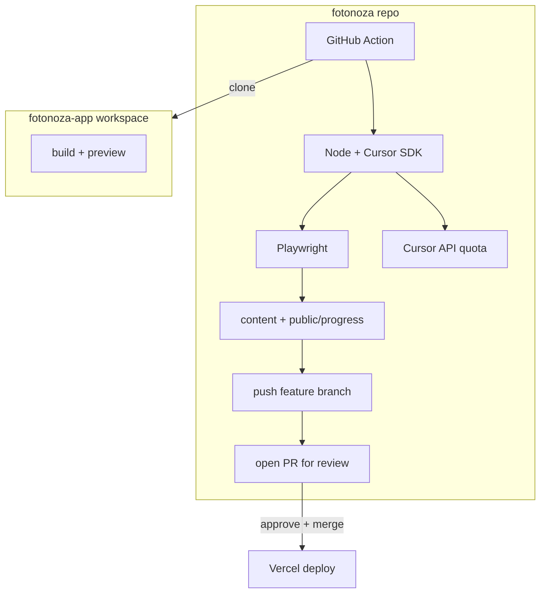

# Progress posts: `fotonoza` (Astro) + `fotonoza-app` (app)

## Where to implement (and where this plan should live)

- **Do the work in the `fotonoza` repo**: Astro content, `package.json` scripts, `scripts/`, Playwright config, `.github/workflows`, README, and committed `progress-state.json` all belong there.
- **Open the `fotonoza` workspace in Cursor** when you “execute” the plan so agents and file edits target the right tree. This [`fotonoza-app`](file:///media/szd/DATA/Projects/Dev/fotonoza-app) checkout is only the source of git history + the app you build for screenshots; optional small changes (testids, `VITE_CI_DEMO`, `repository_dispatch`) are the only edits here.
- **Copying the plan**: yes—paste this plan into `fotonoza` (e.g. `docs/progress-ci-plan.md` or `.cursor/plans/…`) so that repo carries the spec and future sessions do not depend on the app repo. Keeping a copy in both places is optional; **canonical execution context = `fotonoza`.**

## Context

- **Landing / marketing site repo name: `fotonoza`** (Astro, static, Vercel on merge to default branch).
- **App repo**: [`fotonoza-app`](file:///media/szd/DATA/Projects/Dev/fotonoza-app) (clone in CI or locally next to `fotonoza`).
- **Quality gate**: automated runs **never commit directly to the default branch** (`master` or `main`—match your repo). Each finished job **pushes a branch and opens one PR**; **one required approval** (you as owner) before merge → Vercel deploys as today.
- **RepoRep** is **manual on your machine**: `npm run reporep:local yyMMddHHmm yyMMddHHmm` — **inclusive commit-date range**, **each invocation produces exactly one post** (no CI RepoRep batches). CI / scheduled runs use `npm run reporep:ci` (`scripts/RepoRep/RepoRepCi.mjs`).

## Text generation: Cursor quota (not third-party LLM keys)

- Use the **Cursor TypeScript SDK** ([`@cursor/sdk`](https://cursor.com/docs/api/sdk/typescript)): e.g. **`Agent.prompt(...)`** one-shot with a prompt that includes the git summary and demands **strict JSON** (post fields + declarative screenshot plan). Parse and validate output in Node before writing files.
- **Auth**: [`CURSOR_API_KEY`](https://cursor.com/dashboard/cloud-agents) (user key from Cursor dashboard or a **team service account** key if you prefer CI isolation). Store as **`CURSOR_API_KEY`** in GitHub Actions secrets and in local `.env` (gitignored). **No OpenAI/Anthropic/etc. keys** required for the narrative step.
- **Runtime choice**:
  - **GitHub Actions**: after checkout/clone, run a small Node script with **`local: { cwd }`** pointing at the workspace root that contains both repos (or `fotonoza` root with paths to git data). The agent runs **on the runner** but **model usage is billed to your Cursor account** via the API key—this matches “use my Cursor quota.”
  - **Local RepoRep** (`reporep:local`): same pipeline modules, same key in `.env`; natural fit for `Agent.prompt` + `local.cwd`.
- **Optional**: **`cloud: { repos }`** cloud agents for fire-and-forget or long runs—also keyed off `CURSOR_API_KEY`; use only if you explicitly want Cursor-hosted clones instead of Actions checkout. Default plan: **local runtime on the runner / your laptop** for predictable Playwright + `vite preview` in the same process tree.
- **Models**: follow SDK guidance (e.g. `composer-2` or `Cursor.models.list()`); IDs can change—pin via one config constant you update rarely.
- **Quota / ops**: daily job + RepoRep loops consume **Cursor API/agent usage**; batch RepoRep manually over days if you hit limits. Log `run.id` / `agentId` from the SDK for support and retries (`CursorAgentError`, `result.status === "error"` per SDK docs).

## Architecture

## End-to-end flow (scheduled CI — one post per run)

1. Checkout **`fotonoza`** with token that can **push branches** and **open PRs** (`contents: write`, `pull-requests: write`). Use `persist-credentials` / `GITHUB_TOKEN` or a bot PAT with same scopes if default token is insufficient for PR creation from Actions.
2. Clone **`fotonoza-app`** beside or under workspace (depth configurable).
3. **Incremental range**: read committed state e.g. `scripts/progress-state.json` (`lastProcessedSha` on **default branch**—workflow should read from `origin/master`/`origin/main` before branching, or merge state only via merged PRs so state tracks production). New commits = after `lastProcessedSha` through `HEAD` (single group for that daily run = **one post**).
4. Gather `git log` + `git diff --stat` for that group.
5. **Cursor SDK**: `Agent.prompt` (or equivalent) with the git payload + instructions → **validated JSON**: post copy + **screenshot plan** (declarative JSON + fixed runner).
6. **Build app** + **Playwright screenshot** into `fotonoza/public/progress/<slug>.png`.
7. **Write** `src/content/progress/<slug>.md` (+ image ref in frontmatter).
8. **Branch**: e.g. `progress/automated-YYYYMMDD-<shortSha>`.
9. **Commit** on that branch; **push**; **open PR** (`gh pr create` or `actions/github-script` / REST). PR title/body: summary + link to commit range for quick review.
10. **Update `lastProcessedSha` on the same branch** as the post so merging the PR advances state in lockstep with published content.

**No** `git push origin master` (or `main`) from the workflow.

## GitHub repo settings (`fotonoza`)

- **Branch protection** on default branch: **Require a pull request before merging**, **Required number of approvals: 1** (you).
- Optional: **Require status checks** if you add lint/build on PRs later.
- If you use **GitHub Actions bot** to open PRs, ensure rulesets / allowlists let **“GitHub Actions”** or your bot user open PRs from workflow (some orgs restrict this).

## Secrets (`fotonoza` GitHub Actions)

- **`CURSOR_API_KEY`**: Cursor dashboard / service account (see above). **Do not** use third-party LLM provider secrets for the main generation path.
- If **`fotonoza-app`** is private: fine-scoped PAT to clone (unchanged from earlier plan intent).
- **`GITHUB_TOKEN`** or PAT for **push branch + open PR** if default permissions are insufficient.

## Local RepoRep (`npm run reporep:local yyMMddHHmm yyMMddHHmm`)

- **Semantics**: two arguments are **range endpoints** in format **`yyMMddHHmm`** (10 digits each: year 2, month 2, day 2, hour 2, minute 2). Parse into absolute instants (document **timezone**: recommend **UTC** end-to-end and state that in README to match `git` timestamps, or use **local TZ** but then document clearly).
- **Selection**: in `fotonoza-app`, select commits whose **author date** (or committer date—pick one, document) falls **in the closed interval** `[start, end]`. If none: exit non-zero with message.
- **One post**: build the single group → **same Cursor SDK + Playwright pipeline as CI** → write one markdown + one PNG into your local **`fotonoza`** checkout.
- **Git**: local `reporep:local` writes markdown only; use `reporep:ci` (or manual branch + `gh pr create`) when you want commit/push/PR.
- **No** date-range RepoRep in GitHub Actions—only `reporep:local` on your machine for historical windows. Scheduled / manual CI runs use `reporep:ci`.

### Local setup (document in `fotonoza` README)

- **Node** version aligned with Astro project + **`@cursor/sdk`** dependency.
- **Directory layout**: sibling folders `.../fotonoza` and `.../fotonoza-app` (local `reporep:local` always resolves `../fotonoza-app`); CI clones `fotonoza-app` into the repo root.
- **Env**: **`CURSOR_API_KEY`** in `.env` (gitignored); optional **`BASE_URL`** override for preview port.
- **Playwright**: `npx playwright install chromium` (or `install --with-deps` on Linux) once per machine.
- **GitHub CLI** (optional but recommended): `gh auth login` for `gh pr create` from the script.
- **Example**: `npm run reporep:local 2401011200 2401151800` → one post covering commits in that window (exact interpretation per UTC/local doc).

## Shared implementation note

- Factor **“range → artifacts”** into shared modules under `scripts/RepoRep/` used by **both** `scripts/RepoRep/RepoRepCi.mjs` and **`scripts/RepoRep/RepoRepLocal.mjs`** so CI and local RepoRep do not diverge.

## Security

- Declarative screenshot plan + fixed runner; no arbitrary LLM-generated TS in CI without strict gates.
- **`CURSOR_API_KEY`** is powerful: treat like a password; scope CI secret visibility; do not log the key. Run Playwright / preview steps **without** passing the key into child env if possible (generate JSON first, then drop key from env for browser step—defense in depth).

## App repo ([`fotonoza-app`](file:///media/szd/DATA/Projects/Dev/fotonoza-app)) — optional

- `data-testid`, `VITE_CI_DEMO`, web `build` + `preview` for screenshots.

## Risks / limits

- **PR noise**: one scheduled PR per day when there are commits; if empty, skip opening PR.
- **State file**: only advance on merged PRs; avoid updating `lastProcessedSha` on default branch outside merged automation PRs.
- **RepoRep overlap**: running ranges that overlap may duplicate topics—slug from date range + commit set hash to reduce collisions.
- **Cursor limits**: RepoRep many windows in one sitting may hit rate limits—space runs out or add retries per SDK `isRetryable`.

## Optional in `fotonoza-app`

- `repository_dispatch` to trigger `fotonoza` workflow on push.
- Testids / demo mode for screenshots.
